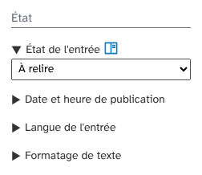
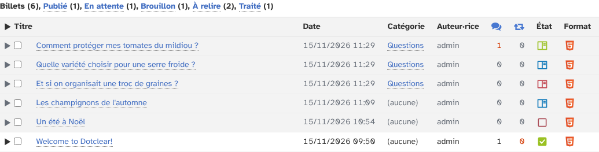

# Proofreading : guide d'utilisation

Proofreading ajoute trois états de relecture à vos billets : « Brouillon », « À relire » et « Traité ». Ces états servent à suivre l'avancement d'un billet avant sa publication. Un billet qui porte l'un de ces états n'est pas visible sur le blog.

## Sommaire

* [Les trois états](#les-trois-états)
* [Changer l'état d'un billet](#changer-létat-dun-billet)
* [Changer l'état de plusieurs billets](#changer-létat-de-plusieurs-billets)
* [Retrouver les billets par état](#retrouver-les-billets-par-état)
* [Bon à savoir](#bon-à-savoir)

## Les trois états

Une fois le plugin installé, la liste des états de Dotclear s'allonge de trois choix :

* « Brouillon » : le billet est en cours d'écriture.
* « À relire » : le billet est prêt pour une relecture.
* « Traité » : la relecture est faite.

Chaque état a sa propre icône dans la liste des billets.

Le plugin n'a pas de page d'administration et pas de réglage. Il n'y a rien à configurer.

## Changer l'état d'un billet

1. Ouvrez un billet dans l'éditeur.
2. Dans la colonne de droite, ouvrez la section « État de l'entrée ».
3. Choisissez l'état dans la liste.
4. Enregistrez le billet.

Dotclear confirme par le message « L'article … a été mis à jour avec succès. ».

## Changer l'état de plusieurs billets

1. Allez dans la liste des billets.
2. Cochez les billets concernés.
3. Dans la liste d'actions en bas, choisissez un état dans le groupe « État ».
4. Validez.

Dotclear affiche alors un message du type « Les entrées ont été mises à jour avec succès et ont désormais le statut «À relire». ».

## Retrouver les billets par état

Dans la liste des billets, le filtre « État » propose les trois nouveaux états, en plus de « Publié », « Non publié », « Programmé » et « En attente ».

Le titre de la liste indique aussi le nombre de billets pour chaque état.

## Bon à savoir

* Les billets « Brouillon », « À relire » et « Traité » n'apparaissent ni sur la page d'accueil, ni à leur adresse publique : elle renvoie une erreur 404.
* Pour publier un billet, choisissez simplement l'état « Publié ».
* Le plugin ne gère ni relecteur, ni commentaire de relecture, ni notification : c'est uniquement un état.
